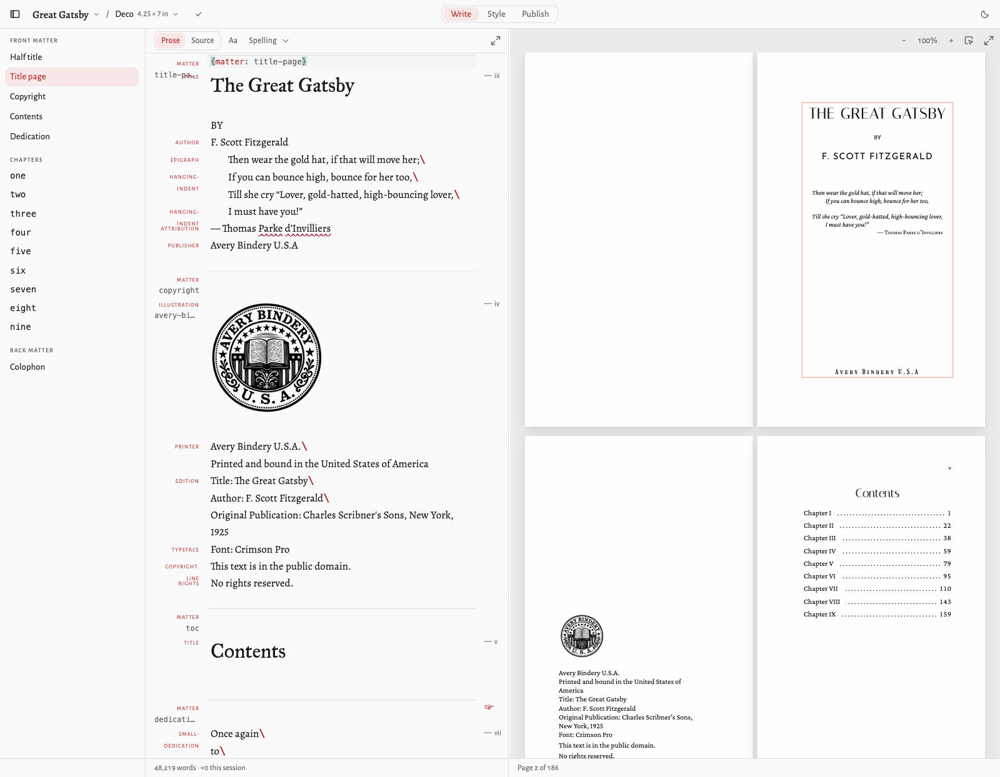
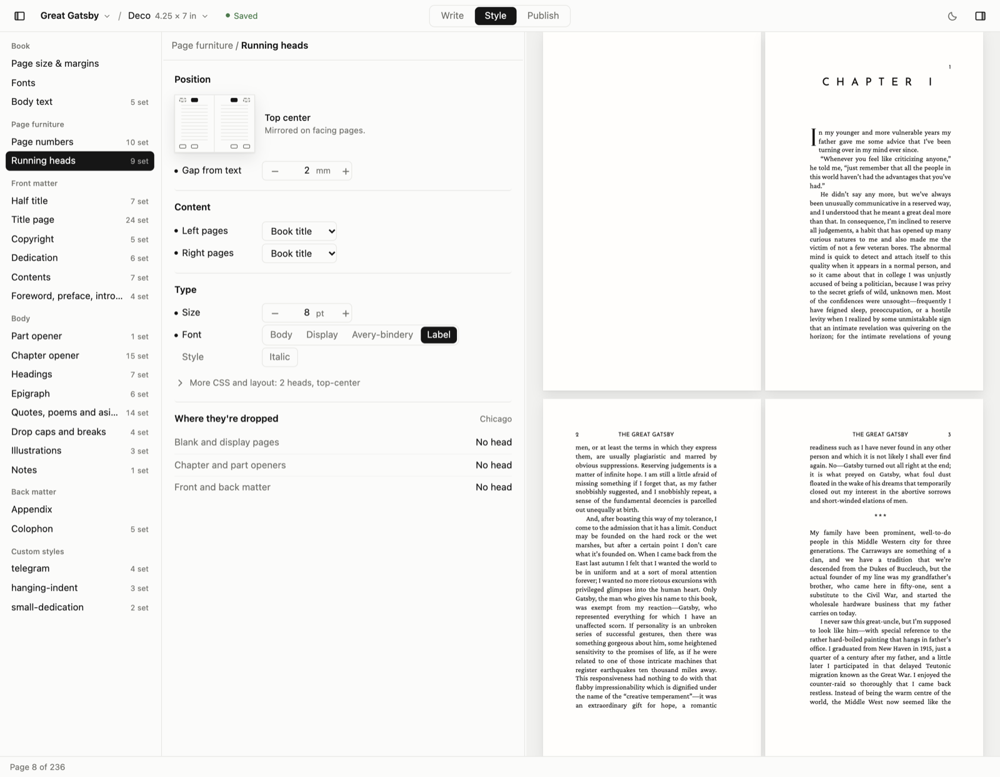

# Wynkyn

Typeset and print hand-bound books, free, from your own files.

You write a manuscript in **BML**, a small semantic markup for prose: chapters,
epigraphs, poems, pull quotes, sidebars, drop caps, footnotes. All styling lives
apart from the words in `metadata.json`. Wynkyn lays the book out in your
browser with [Paged.js](https://pagedjs.org/), shows the real pages as you
write, and prints them imposed into folded signatures for binding by hand. It
also writes a reflowable EPUB.

Named for Wynkyn de Worde, Caxton's apprentice and the first printer to set up
shop on Fleet Street.



## Running it

With [Deno](https://deno.com/) 2.x installed:

```sh
git clone https://github.com/JakeAve/wynkyn && cd wynkyn
deno task setup   # once: git hooks, dev port, books/ in a worktree
deno task dev     # http://localhost:8000
```

Books live in `books/` next to the checkout. The dev server watches them, so
edits from any editor appear in the preview, and the app's saves land in the
same files. The CLI covers the rest, including a print export that renders the
PDFs in a headless Google Chrome:

```sh
deno task bml list                    # books on disk
deno task bml new <slug>              # scaffold books/<slug>/ from the house style
deno task bml check <book>            # parse diagnostics as file:line: msg (exit 1 on any)
deno task bml render <book> [out]     # standalone HTML, default books/<book>/render.html
deno task bml export <book>           # print-ready sheet PDFs into books/<book>/export/
deno task bml epub <book>             # books/<book>/export/book.epub
```

`export` takes `--proof` (one signature to test a new printer), `--sheet`,
`--folios` and `--duplex`. Fold a proof by hand before committing paper to a
full print.

## A book on disk

```
books/<slug>/
  manuscript.md    BML source: semantic markup only, no styling
  metadata.json    trim size, margins, fonts, and every style rule
  editions/        optional: more metadata files, one per edition
  images/          illustrations and ornaments
```

A manuscript looks like this. These are the opening lines of _The Great Gatsby_
as the editor holds them:

```
{chapter: one}

{dropcap}
In my younger and more vulnerable years my father gave me some advice
that I’ve been turning over in my mind ever since.

“Whenever you feel like criticizing anyone,” he told me, “just
remember that all the people in this world haven’t had the advantages
that you’ve had.”
```

And this is the same passage on the page, with the Style tab open on the running
heads. Everything on the right comes from `metadata.json`: the chapter opener,
the drop cap, the heads and the folios. Click anything on a page and the panel
opens on the style that drew it.



Every block starts with a sentinel in braces; the words stay plain text. The
full language is §3 of [book-renderer-spec.md](book-renderer-spec.md), and
`deno task bml check` reports anything the parser doesn't understand.

## Fonts

Styles name Google Fonts families, which load from Google in the browser and
embed freely in PDFs and EPUBs. Fonts installed on your computer work for print;
the EPUB embeds them only when the font file says it may.

## Developing

```sh
deno task check       # fmt --check, lint, type check
deno task test        # the whole suite (needs Chrome); test:fast skips the browser tests
deno task build:site  # the hosted app as plain files in dist/
deno task serve:site  # serve dist/ on :8010 the way a static host would
```

The hosted site also serves `/llms.txt`, `/spec.md` and
`/convert-manuscript.md`, so an AI agent told "I'm on this site, help me with my
book" can find the format and the house conventions.

`setup` points `core.hooksPath` at `.githooks/`, so `check` and the fast tests
run on every commit and the full suite on every push. CI does the same on every
push and pull request.

| Path        | What it does                                                      |
| ----------- | ----------------------------------------------------------------- |
| `parser/`   | BML → document tree (pure)                                        |
| `metadata/` | `metadata.json` → CSS                                             |
| `renderer/` | tree → HTML, `base.css`, and the Paged.js handlers for folios     |
| `server/`   | the store seam, build pipeline, book service, dev server, exports |
| `web/`      | the browser app: editor, style panel, paginated preview, print    |

One pipeline serves everything: the preview, the print export and the EPUB all
run `parse → render → css` the same way. The book service that saves, merges
styling and manages editions is written over a small file-store interface, so
the same code runs in the Deno dev server over `books/`, in the browser over a
folder you pick, and in the desktop app to come. `CLAUDE.md` and
`.claude/skills/architecture` describe the layout in detail.

Tests are plain `Deno.test`, next to the module they cover. Two public domain
books under `testdata/`, Paine's _Common Sense_ and _The Great Gatsby_, are the
full-grammar regression corpus, so the suite passes on a fresh clone.

## License

MIT — see [LICENSE](LICENSE).
